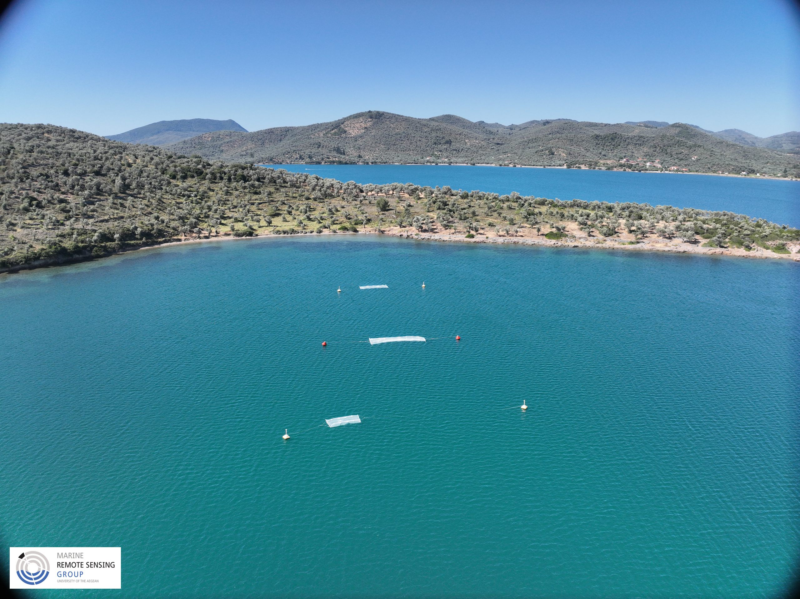

# Detecting small floating plastic targets from space: Repeated multispectral and hyperspectral observations from Plastic Litter Project 2026

*Manuscript in preparation for submission.*

## Study Overview

This study examines how the detectability of three small floating plastic targets deployed in the Gulf of Gera, Lesvos, Greece, varies across four satellite sensors (Sentinel-2, PlanetScope SuperDove, EnMAP, and PRISMA) and five sets of observations. The analysis compares target–water reflectance contrast, evaluates spectral similarity for target detection, and examines recurring spectral differences between targets and water.

*Drone view of the PLP2026 field site and the three floating plastic mesh targets in the Gulf of Gera, Lesvos, Greece, on 29 June 2026. Photo by the Marine Remote Sensing Group, University of the Aegean.*

Field experiment records and photographs are described on the [Plastic Litter Project 2026 website](https://plp.aegean.gr/plastic-litter-project-2026/).

## Code and Data

The code and data are being prepared for release alongside the manuscript.

- **GitHub** — Analysis code for target–water reflectance comparisons, Spectral Angle Mapper (SAM) evaluation, and continuum-removed band depth (CRBD) calculations, with an example using synthetic spectra and instructions for running the code.
- **Zenodo dataset** — Selected results, including SAM evaluation tables, and a data dictionary. Additional reflectance and CRBD data are under review for release.

Links to the dataset and archived code release will be added when available.
